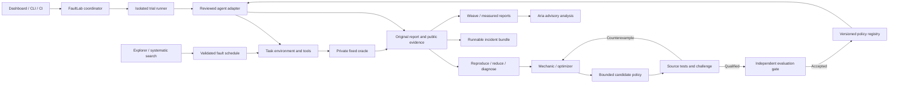

# FaultLab: the next 30 days

**Proposed plan · September 20, 2026 · two full-time builders, supported by coding agents.**

Latest execution is tracked in [PHASE3_TASKS.md](PHASE3_TASKS.md), with measured outcomes in [PHASE3_RESULTS.md](PHASE3_RESULTS.md). Search diversity and a separate completion experiment are implemented; generated repair remains unproven. The next focused recommendation is to expose the Actor's already-public attempted-write progress and measure it against the unchanged baseline before more repair search. [Phase 2](PHASE2_RESULTS.md) and [Phase 1 results](PHASE1_RESULTS.md) preserve the preceding work. The original proposal below remains the baseline roadmap.

Read this first. The [current-state audit](CURRENT_STATE.md) contains code references, actual results and unfinished hackathon tasks. The [research notes](RESEARCH.md) contain the papers and competing tools behind these recommendations. This document proposes work; it does not claim that the work or experiments have happened.

## The recommendation

Keep FaultLab and build on the existing engine. First finish the missing proof of improvement. Then make the lab useful to another developer with another agent and another task.

The product promise should be:

> **Turn an agent failure into a reproducible test, test a repair, and check whether it holds up on new cases.**

Today we have a working test track for one order workflow. In a month, aim for a usable reliability workbench with two test environments, independent agent support, runnable failure reports, a repair experiment, and a release gate that another team can use.

The important distinction: a developer should get a useful failing test even when FaultLab cannot discover a repair. Automatic repair is the most ambitious part, and it should remain visible and measured rather than holding every other useful output hostage.

There is one schedule assumption to confirm outside this plan: the [public Fully Connected conference](https://www.coreweave.com/fully-connected-2026) is listed for September 29–October 1, 2026. That is sooner than a month from this audit. Your Part 2 may be a different event. The roadmap below uses the 30 days you requested, with a credible demonstration checkpoint by Day 8–10.

## Where we are starting

We have real fault injection, state-based checking, reproduction, reduction, diagnosis, model proposals, adversarial challenge, stored evidence and a usable dashboard. The current checkout passes 367 backend tests, 25 frontend tests, a production build and three browser fixture tests.

We do **not** yet have an accepted learned repair, measured transfer to the independent agent, a completed final audit, or a clean-clone experience that carries the real evidence with it. The 117 checked hackathon tasks mostly establish machinery; the five open tasks contain much of the remaining uncertainty.

Claude's changes are already integrated. Reuse them. Do not start another implementation or copy the old handoff over the current source.

## The month-end target

These are delivery targets, not results we can declare in advance.

| Target | What a reviewer should be able to do |
|---|---|
| A useful developer tool | Install, inspect a real sample without credentials, connect a documented agent, run a bounded test, and understand the failure |
| Two task environments | Use the existing shop and one genuinely different task with its own reset and correctness rules |
| Independent agent support | Run the existing FaultLab Actor and native smolagents; add a further framework only after these work well |
| Portable incidents | Export a complete failure bundle; inspect it elsewhere and rerun it in a fresh sandbox |
| A measured repair result | Inspect a generated candidate, failed attempts, challenges, independent evaluation and, if it qualifies, restart reuse |
| A useful release check | Run selected regressions from pytest/CI and see failures, improvements, healthy regressions, cost and latency |
| A defensible demonstration | Show one complete evidence story, including a rejected repair, with links to the recorded trials |

The research target is at least one genuinely useful generated repair that passes the unchanged original gates. The engineering target is a product that still produces useful, inspectable tests if that research target fails. A deadline must not change a verdict.

## Why this direction

Research found substantial overlap with existing tools. AgentChaos studies runtime fault injection; Flakestorm already describes faults, contracts, replay and CI. Weave and other evaluation platforms already provide tracing and scoring. Our opportunity is therefore the **quality of the full state-aware test-and-repair workflow**, not an unsupported claim that agent testing is new. See the [source comparison](RESEARCH.md).

| Direction | Upside | Main difficulty | Decision |
|---|---|---|---|
| Test, reproduce, repair, verify, export | Uses most of our existing code; understandable developer value | Must demonstrate repair/generalization and make integration easy | Main product |
| Agent training platform | Strong fit with CoreWeave/W&B; could improve a small model | Requires stable rewards, data, training access and independent evaluation | One bounded experiment after the lab is trustworthy |
| Automatic environment generator for arbitrary agents | Impressive if it worked | Schemas do not specify all state semantics, reset behavior or truth; generated tests can approve generated mistakes | Future assisted authoring, with human review |
| Broad agent observability dashboard | Easy to explain | Crowded; does not use our strongest work | Integrate with Weave; avoid duplicating it |
| A single production operations agent | Concrete use case | Changes FaultLab into a different product | Use an operations workflow as a test environment instead |

The first users to seek are developers with an agent that updates orders, tickets, bookings or jobs. During Week 1, show the current failure to three to five developers and ask for an actual failure they would want to rerun. These conversations can change the second task choice. Do not assume that a conference audience proves demand.

## What to build

### 1. Finish and improve the existing learning loop

Fix the confirmed problems before trying more model names:

1. Give the Mechanic the complete, neutral hook contract: exactly when each hook runs, what it can observe, what it can change, and how it affects remaining turns.
2. Include the previous candidate, its hash, the triggering challenge recipe and cumulative failed outcomes in the next repair request.
3. Deduplicate proposals within the same frozen runtime, parent policy and source context. Save repeated proposals, but do not give the same failed policy fresh chances to qualify through a lucky sample. Any planned repeat measurement should aggregate under the same candidate identity.
4. Separate a failed repair from an incumbent that no longer reproduces. Keep source flakiness visible.
5. Hash the experiment algorithm and record the exact code revision/runtime identity, not only the agent prompt and interpreter.
6. Correct telemetry classification and preserve sanitized causes of campaign errors.

A supported diagnosis is not a guarantee that the allowed policy can fix the problem. Explicitly label three situations: insufficient evidence; a proposed repair failed; the required behavior is outside the current patch interface. This avoids spending large amounts on an impossible patch surface.

Do not silently generate the Actor's final report on its behalf. If we change report protocol or turn allocation, apply the same change to baseline and candidate, version the experiment, and measure again. A stronger model or better controller can be a useful comparison, but it is a different intervention from a learned recovery policy.

### 2. Make every reproduced failure a deliverable

Export after reproduction/reduction and after a failed challenge, rather than waiting for promotion. Keep artifact types explicit:

- **Incident fixture:** this task and fault can produce a particular failure.
- **Candidate comparison:** this proposed policy was tested against that failure.
- **Accepted policy bundle:** this candidate passed the stated independent gate.

An incident bundle should include the task, initial-state fixture, allowed fault schedule, observed trigger, original report, checks, event sequence, configuration and code identities, all related proposals and results, dependency/container versions, and instructions for trusted fresh execution. Private evaluation cases and credentials stay outside public archives.

Offer three separate modes: inspect a saved recording; validate bundle integrity; execute a fresh test. A fresh model run may differ from the saved run even with the same settings. Deterministic environment reset is not deterministic model behavior.

### 3. Introduce a small, explicit integration contract

Build around the existing reviewed agent registry. Separate these responsibilities:

| Interface | Responsibility |
|---|---|
| `AgentAdapter` | Invoke the original agent, connect public tools, preserve original outputs, expose supported policy hooks |
| `TaskPack` | Task schema, initial-state fixtures, public service contract, capabilities and supported faults |
| `World` | Fresh reset, tool execution, logical-time behavior, fault trigger ledger and private state |
| `Oracle` | Fixed checks against private truth and delivered evidence; never supplied by the repair model |
| `RepairSurface` | The exact permitted changes: current bounded policy first; separately versioned prompt/controller changes later |
| `ExecutionBackend` | Run one isolated trial locally or in a reviewed remote sandbox |

Start with Python and HTTP, where our code already works. Add an MCP transport adapter if a pilot agent needs it. MCP standardizes tool communication; it does not supply reset semantics, a business oracle or an automatic fake world.

The first independent target is the existing smolagents integration. Run its baseline/conformance independently while repair work continues. Transferring an unchanged accepted policy remains a separate later experiment; it still requires an accepted source policy.

### 4. Add one second task that proves the separation

Recommended custom task: **submit one batch job, track its outcome, retrieve the matching output, and report truthfully**. This is understandable to the CoreWeave audience and naturally exercises asynchronous state.

Example failure: the service accepted the job but the acknowledgement was lost. The agent must recover the original job identity rather than creating duplicate work. A stale status or missing output must not become a false completion claim.

Use a local synthetic job service first, with a separate fixed oracle: correct authorized job, no duplicate submission, correct result identity, and honest completion/uncertainty. A later sandbox-backed dummy job can make execution realistic without using a production account as a fault target.

A different event-focused simulation alone is not external validation. For an additional benchmark comparison, time-box an adapter to a small **pinned τ-bench/τ²-bench task subset**. Keep its native scorer authoritative and report any custom fault extension separately from the original benchmark. If this adapter becomes expensive, finish the two well-tested task packs first.

Do not duplicate the whole engine to add the new domain. The second pack succeeds when most changes are in task definitions, tool mappings and checks.

### 5. Improve search and repair with controlled experiments

For search, compare the current Explorer with the existing systematic baseline and a coverage-guided mutation strategy. Track meaningful unique failures per model call and per elapsed minute. Reward reaching new behavior and finding a new failure mechanism, not merely producing more JSON scenarios.

For repair, compare the corrected Mechanic with a **GEPA-inspired or GEPA-backed proposal generator**. Its role is to propose changes from execution feedback. The fixed parser, policy permissions, scorer and final evaluation remain outside its control. A small candidate history with explicit differences is more useful than repeated identical proposals.

Keep the same allowed repair surface when comparing optimizers. If a separate experiment optimizes an Actor prompt or controller, label that intervention clearly; it is not unchanged-policy transfer.

### 6. Make results easy to understand

Improve the current UI around one journey:

**Choose agent and task → run tests → open an incident → compare candidate → export or rerun.**

Add a campaign history browser, filters, a clear selected agent/model/configuration, and readiness state. On an incident page show the requested action, what the agent saw, what actually happened, the violated rule, and the exact change proposed. Put detailed hashes and raw JSON one click away.

Add side-by-side baseline/candidate traces, actual trigger coverage, cost/latency and repeated-run variation. Keep failed proposals and NO_CHANGE visible. A compact result report should explain why the previous policy stayed active.

The current dark UI is already sufficient visually. Prioritize navigation, evidence completeness and explanation over another cosmetic rewrite.

## Architecture for the next version

Keep React, FastAPI, Pydantic, the simulator/referee separation, policy validation and the trace outbox. Refactor by boundaries; do not rewrite the application into a new agent framework.

Preserve one authority for every verdict. The agent receives public observations; the oracle sees private state. Aria explains results but cannot promote a policy. The screenshot/report path can use immutable exported records without execution credentials.

For scale, first introduce bounded workers around the existing trial unit. Use one fresh world, conversation and budget allocation per trial. Parallelize independent cases, not a single agent's ordered tool actions. Test that cancellation, reservations and cleanup remain correct under concurrency.

Keep SQLite for local mode. For a shared runner, use a durable job table/queue, explicit leases, Postgres-backed metadata and artifact storage. This is a deployment mode, not a requirement to replace the local tool. An interrupted non-idempotent action cannot simply be retried: reconcile its recorded identity or mark the trial interrupted and start a new declared trial.

CoreWeave Sandboxes is a promising optional execution backend; its documentation describes isolated parallel sessions and cleanup. Confirm account access and network behavior before depending on it. The local backend must remain usable if preview infrastructure is unavailable. [Official sandbox documentation](https://docs.coreweave.com/products/sandboxes/client/tutorial/multiple-sandboxes).

Publish a read-only report viewer before exposing an execution service. Shared paid execution needs authentication, authorization, secret handling, rate limits and isolation; the current localhost API does not provide that boundary.

## The four-week schedule

| Window | Main work | Exit evidence |
|---|---|---|
| Days 1–3 | Reconcile status; preserve a baseline; fix hook context, candidate feedback/dedup, trace classification and runtime fingerprinting; add focused tests | A reviewed release candidate with full offline checks, one coherent configuration and a declared experiment plan |
| Days 4–7 | Execute corrected learning experiments; classify source flakiness; export failures; run an independent smolagents baseline; add CI/readiness | A real incident another machine can inspect/rerun; complete unique-candidate results; a repair outcome, including NO_CHANGE if appropriate |
| Days 8–14 | Agent/task interfaces, campaign browser, complete archive import/export, regression CI command, second task pack | Both agent implementations work through the documented boundary; second domain has working reset/oracle tests; early demo is repeatable |
| Days 15–21 | Coverage-guided search; equal-budget optimizer comparison; bounded parallel workers; pilot integrations | Measured search/repair results, actual integration effort, isolated concurrent trials; optional CoreWeave sandbox run |
| Days 22–26 | Freeze release candidates and new evaluation partitions; original final/transfer studies if eligible; broader independent comparisons | Raw results, uncertainty, healthy regressions and overhead; no changes based on final-test feedback |
| Days 27–30 | Fix release blockers without retuning the frozen result; documentation, license decision, clean install, read-only report, demo rehearsal | Reproducible release, public evidence package, five-minute story and backup recording |

Run small pilot conversations throughout the month. Target two outside integrations; access to willing teams is an external dependency, so do not promise their availability. Measure time to first useful result and how much adapter code they needed.

**Day 8–10 fallback:** ship the corrected lab, one real incident bundle, a truthful repair/challenge report and a short reproducible demo. This is useful even if the event occurs before the full month is available.

## Prioritized implementation backlog

Each item should become a small reviewable change with evidence. These are proposed tasks, not completed checkboxes.

| ID | Work | Starting files / area | Acceptance |
|---|---|---|---|
| P2-01 | Current status and configuration reconciliation | Handoffs, launch scripts, status API | One current source/configuration identity; historical results remain distinct |
| P2-02 | Precise hook/repair contract | `lab/diagnosis.py`, prompts, interpreter tests | Mechanic sees timing/capabilities without seeing a solved policy |
| P2-03 | Candidate identity and cumulative feedback | `lab/learning.py`, `policies.py`, `challenge.py` | Duplicate proposal consumes no new qualification batch; challenge recipe/candidate/outcomes survive |
| P2-04 | Flaky-source classification | Learning/evaluation result schema | Source non-reproduction differs from candidate violation; raw outcomes preserved |
| P2-05 | Runtime/protocol provenance | `lab/configuration.py`, freeze/export | Acceptance-logic changes alter algorithm identity; code revision and dirty state recorded |
| P2-06 | Correct evidence and operator readiness | Telemetry, coordinator, health/UI | Report failure ≠ infrastructure failure; unavailable simulator is found before starting a paid task |
| P2-07 | Reliable sponsor completion | Aria bridge and evidence capture | Deterministic remote identity reconciled; no duplicate automatic dispatch; source counts explicit |
| P2-08 | Export on useful failure | Regression compiler and loop | Reproduced and challenged failures export without claiming a learned policy was accepted |
| P2-09 | Complete evidence archive/viewer | CLI export, event API, frontend | Another machine opens all trials/proposals/events read-only without the original DB or credentials |
| P2-10 | Independent-agent onboarding | Registry, smolagents adapter, campaign request/UI | Native external agent runs healthy and fault cases with original output preserved |
| P2-11 | Task-pack abstraction and second task | Simulator, contracts, oracle, adapters | Shop and job workflow use the same runner; separate correct reset/oracle behavior |
| P2-12 | Fresh test / pytest / CI interface | Existing scripts and trusted runner | Explicit fresh execution; offline CI needs no secrets; clear exit codes and result artifacts |
| P2-13 | Search and optimizer comparison | Explorer, search benchmark, Mechanic | Same declared budgets/populations; unique failures and all candidate attempts retained |
| P2-14 | Bounded parallel execution | Coordinator, ledger, isolated workers | No shared worlds; durable cancellation/accounting; comparable results at concurrency 1 and 4 |
| P2-15 | Freeze and measure | Audit/portability/freeze tools | Eligible original gates executed; final cases not exposed to optimizers; report all outcomes |
| P2-16 | Release and pilot usability | Packaging, docs, license, report viewer | Fresh-clone walkthrough succeeds with a developer who did not build the app |

P2-01 through P2-06 are the immediate learning prerequisite. P2-08/P2-09 and independent-agent baseline work can proceed in parallel. P2-14 must wait for isolation and provenance; faster incorrect experiments are not an improvement.

## What to measure

### Keep comparisons fair

Preserve the original B0/B1/L definitions when closing old tasks: model Actor with no learned policy, handwritten reference, and the learned-policy arm. The handwritten reference is a useful engineering comparator, not proof of model learning.

For new repair experiments, baseline and candidate must use the same agent/model, prompts except the declared patch, environment, fault distribution, tool contract, budgets and scorer. Pair matched initial states and schedules in fresh worlds. Changing the Actor and repair simultaneously cannot isolate the repair's effect.

### Declare the experiment before running it

Choose tasks, scenarios, repeats, allowed candidate count, budget, metrics and stopping rules in advance. Keep development, selection/promotion and final evaluation separate. Existing public audit fixtures can close the historical protocol, but a stronger month-two generalization claim also needs a newly versioned held-out suite. Once final feedback informs a change, that suite is no longer untouched for the next claim.

Keep the original three-trial gates for their original acceptance claim. Add a separate broader evaluation rather than quietly relaxing those gates or cherry-picking a successful batch. A reasonable initial broader design is 12–20 frozen scenarios per task with 10 repeated paired trials per supported configuration, followed by a predeclared larger sample for critical cases. Choose the final counts after a small separate pilot, then lock them. This is a proposed workload, not a guarantee of statistical power.

Report confidence intervals and paired differences. Treat repeated trials within a scenario as a group when summarizing across scenarios. Zero observed failures does not establish zero failure probability. `pass^k` asks whether all k repeats succeeded; it is not `pass@k`, which rewards at least one success. The distinction matters for reliable agents. [τ-bench](https://arxiv.org/html/2406.12045v1).

### Use several visible metrics

- Useful completed tasks, truthful unresolved outcomes and correct rejections, separately.
- Violations by type: duplicate effects, unauthorized changes, wrong result identity, unsupported success, missing/invalid report.
- Scheduled, reached and triggered faults, with clear denominators.
- Reproduction rate and candidate repair rate across all registered attempts.
- Healthy-path regression and extra calls/latency.
- Unique reproduced failures per resource budget for each search method.
- Unique candidate policies, duplicate proposals, source failures, challenge failures and accepted policies.
- Provider failures, lab failures, interrupted trials and missing evidence, separately.
- Actual tokens, measured wall time and known cost; admitted ceilings and unknown billing stay distinct.

Do not combine these into a single attractive score. An agent that avoids every task may be safe but useless. An agent that completes most tasks but duplicates expensive actions may be unacceptable.

### Model selection

Do not choose the Actor just because it fails dramatically, or call the largest model the best without measurement. Use a small capability check: valid actions/reports, healthy task competence, tool use, measured latency and actual model identity. Select at least a smaller and a stronger competent Actor for the report; keep the best validated lab model for proposals. Record all screening criteria and failures.

The latest launcher defaults are not established live results. Verify current W&B model access and pricing when experiments actually begin. Preserve historical settings rather than editing their labels.

## Parallel work with agents

Two people can oversee four workstreams, with bounded agent tasks and shared interfaces:

| Workstream | Human review focus | Agent-sized work |
|---|---|---|
| Learning and experiments | Protocol, fairness, what the result means | Hook context, feedback, dedup, diagnostics, experiment summaries |
| Environments and integrations | Business semantics, correct oracle, original agent behavior | smolagents onboarding, second task, adapter conformance |
| Evidence and execution | Identity, isolation, recovery, spend accounting | Complete archives, readiness, telemetry corrections, workers |
| Developer experience | Can another person understand and use it? | Campaign browser, report viewer, CLI/CI, documentation and release checks |

Agree on shared contracts before parallel edits. One owner should approve schema changes, migrations, evaluator changes and experiment plans. Run experiments against a pinned checkout/container; do not edit a running experiment's source. Keep research candidates in separate branches/worktrees and merge only after tests and review.

Maintain a short daily record: what changed, which experiment ran, what it showed, what remains uncertain, and the next decision. Give coding agents bounded implementation tasks, not a vague instruction to make the benchmark pass.

## Stretch work if the main path is healthy

Use the generous resources on independent measurements and useful comparisons first. Then choose **one** larger experiment:

1. **Small-model training:** export reviewed development trajectories and compare a small ART/Serverless RL or SFT model with the original Actor and the policy-overlay approach. Use fixed state-based rewards, separate safety/utility metrics and untouched evaluation. This introduces weight training as a new method; it does not retroactively change what the hackathon built. W&B documents managed SFT/RL and LoRA serving, currently in preview. [Official documentation](https://docs.wandb.ai/serverless-training).
2. **Assisted task-pack authoring:** use tool schemas and examples to draft a test environment and suggested rules, then require developer review and conformance tests. Measure how much setup time it saves. Never let the same generated model define and approve its own success.
3. **Production trace → staging regression:** accept a sanitized incident, map it to an approved task pack, and reproduce it in staging. A trace alone cannot reconstruct the missing state or prove that the synthetic reproduction matches production.

Prompt-injection testing, broad multi-agent failure propagation, a marketplace, unrestricted generated code repairs and public autonomous production changes are separate projects. They can be valuable later, but each needs a new threat model, oracle or operational boundary.

## The first 48 hours when implementation begins

1. Preserve this audit and old results; choose the exact current runtime/model configuration and a clean experiment checkout.
2. Implement P2-02/P2-03/P2-05 with focused tests; add P2-04 and the report-error telemetry correction before interpreting a new campaign.
3. Add simulator/configuration readiness and stop hiding the sanitized cause of execution failures.
4. Declare the first bounded experiment and run the corrected loop. If it fails, inspect the failure stage; do not keep rerunning until a three-trial batch turns green.
5. In parallel, export one existing reproduced incident into a complete inspectable archive and start the smolagents baseline path.
6. Publish a short result entry: exact revision/configuration, reached stages, all unique policies, outcome and next hypothesis. Update the current status page, not a new contradictory handoff.

At Day 7, decide based on evidence: if a repair qualifies, proceed to restart/freeze/audit and unchanged-policy transfer. If it does not, retain the repair research track while shipping incident/regression utility. Investigate whether the remaining limitation belongs to the Actor, the allowed patch interface, or the service contract.

## What to show leadership

A five-minute demonstration should answer one question: **can a team use this to catch and prevent an agent failure before a release?**

1. Show the normal task and what correct behavior means.
2. Introduce a real controlled failure and compare the agent's claim with the service's actual state.
3. Open the reproduced incident and its runnable test.
4. Show a proposed repair, a challenge that rejects a weak candidate, and the actual independent decision for the final candidate.
5. Run or replay the same integration on the independent agent or second task, clearly labeling which it is.
6. End on the release report: measured results, known limitations, and how another developer can run it.

Use the actual outcome if no candidate is accepted. Do not script a fake success. Prepare a complete local recording and a short live step so the demonstration does not depend on an entire research campaign completing on stage.

The desired change over the month is concrete: **from a promising experiment on our laptop to a reproducible tool another team can use, with evidence for exactly what its repairs do and do not improve.**
